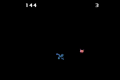

# hot-pursuit
This is a game about running away. You the player must run away from odd creatures which chase you. The longer you survive, the more score you collect. If you are caught the game restarts and your top score is saved.
This was a project to practice object-oriented programming in c++.

Here is the github pages link to try it out: [GameSite](https://the-arctic-winter-7.github.io/hot-pursuit/)
